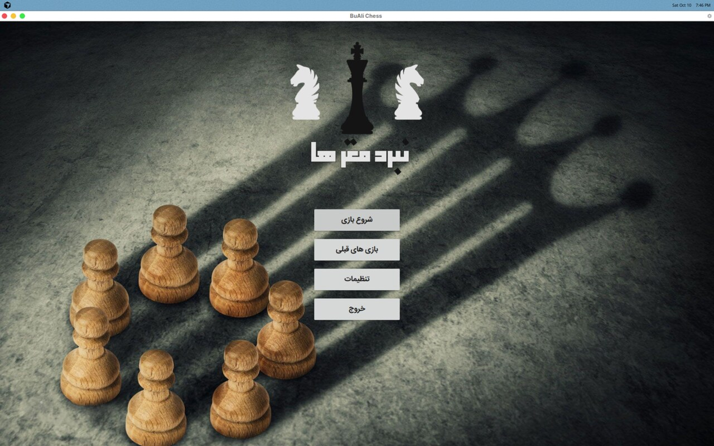
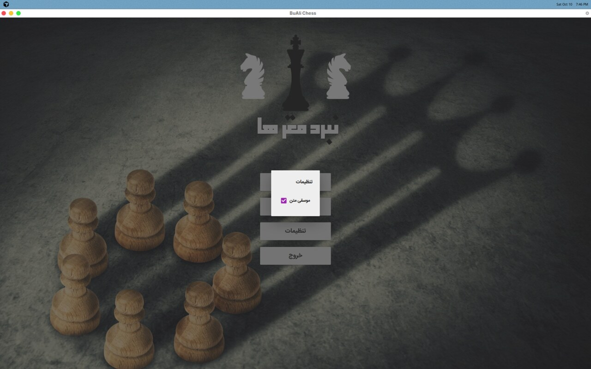
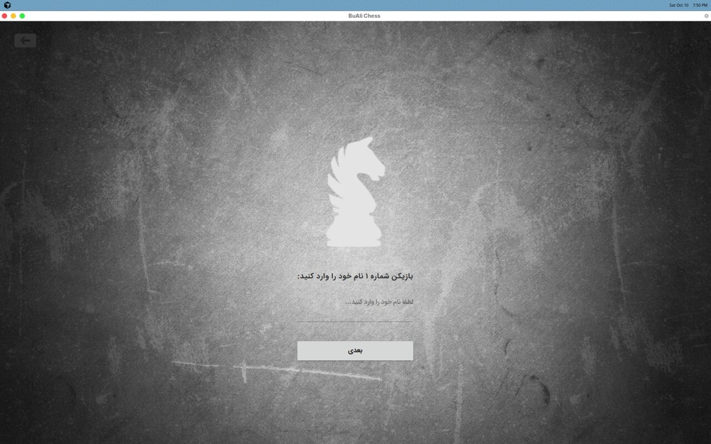
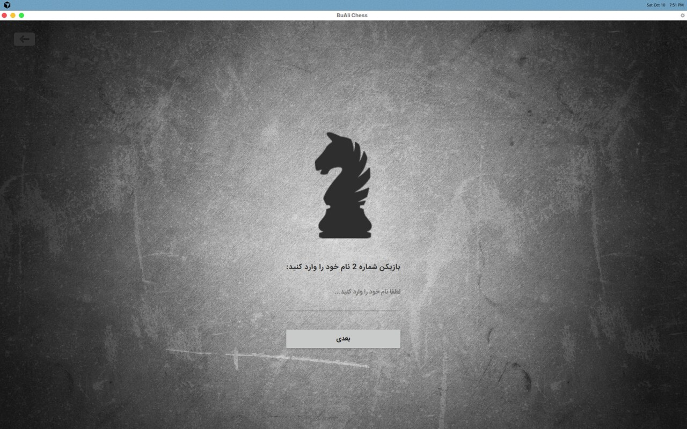
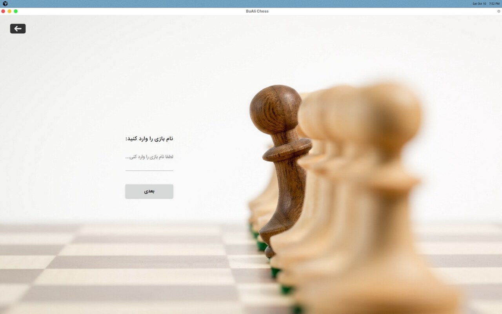
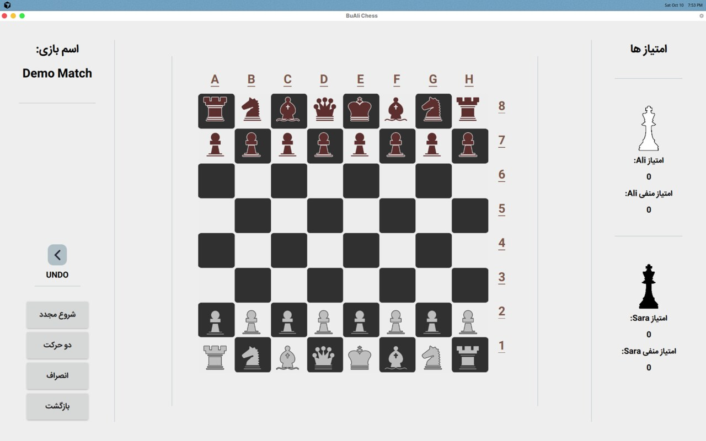

# BuAli Chess — نبرد مهره‌ها

پروژهٔ بازی شطرنج برای درس برنامه‌سازی پیشرفته، دانشگاه بوعلی سینا.

امتیاز پروژه: **۱۷۳ / ۱۰۰**

بک‌اند با **C++** و رابط کاربری با **Qt Quick / QML** (همراه با JavaScript) پیاده‌سازی شده است.

---

## Demo

### صفحهٔ اصلی



### تنظیمات



### ورود نام بازیکنان

| بازیکن ۱ | بازیکن ۲ |
|:---:|:---:|
|  |  |

### نام بازی



### صفحهٔ شطرنج



---

## ویژگی‌ها

- طراحی شی‌گرا (OOP) برای مهره‌ها، صفحه و منطق بازی
- ذخیره و بازیابی داده از طریق فایل
- عملکرد سریع به‌خاطر بک‌اند C++
- رابط Material Design با انیمیشن‌های Qt Quick
- رابط فارسی
- Undo، شروع مجدد، دو حرکت، انصراف
- امتیازدهی بازیکنان
- موسیقی متن و افکت‌های صوتی

---

## ساختار پروژه

| مسیر | توضیح |
|------|--------|
| `main.cpp` / `main.qml` | نقطهٔ ورود برنامه |
| `Welcome.qml` | منوی اصلی |
| `Player1.qml` / `Player2.qml` | ورود نام بازیکنان |
| `Gamename.qml` | نام بازی |
| `ChessBoard.qml` | صفحهٔ بازی |
| `Review.qml` | بازی‌های قبلی |
| `src/` / `include/` | منطق C++ (مهره‌ها، صفحه، فایل، اتصال به QML) |
| `media/` | تصاویر، فونت و صدا |
| `demo/` | اسکرین‌شات‌های دمو |
| `Bu-Ali Chess (linux)/` | نسخهٔ آمادهٔ لینوکس |
| `Bu-Ali Chess(windows)/` | نسخهٔ آمادهٔ ویندوز |

---

## اجرا

### ویندوز

فایل اجرایی را از پوشهٔ `Bu-Ali Chess(windows)/` اجرا کنید.

### لینوکس (نسخهٔ آماده‌شده)

```bash
cd "Bu-Ali Chess (linux)"
chmod +x chess.sh bin/chess
./chess.sh
```

> اگر وابستگی‌های Qt همراه بسته کامل نباشد، از ساخت از سورس استفاده کنید.

### ساخت از سورس (Qt 5)

پیش‌نیازها (Ubuntu / Debian):

```bash
sudo apt install qtbase5-dev qtdeclarative5-dev qtquickcontrols2-5-dev \
  qml-module-qtquick-controls2 qml-module-qtmultimedia \
  qml-module-qtgraphicaleffects qt5-qmake g++
```

ساخت و اجرا:

```bash
mkdir -p build-qt && cd build-qt
qmake ../chess.pro
make -j$(nproc)
./chess
```

---

## تکنولوژی‌ها

- C++11
- Qt 5 (Quick, Quick Controls 2, Material, Multimedia)
- QML + JavaScript

---

## مجوز / درس

پروژهٔ آموزشی دانشگاه بوعلی سینا — برنامه‌سازی پیشرفته.
